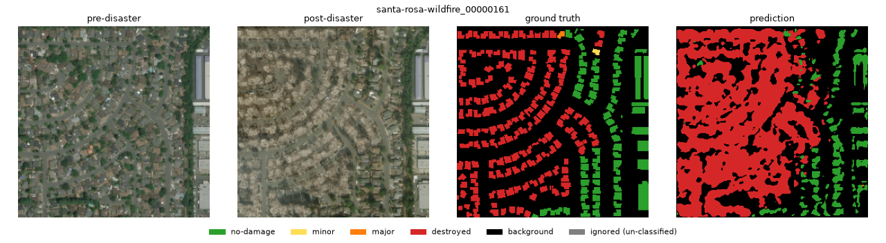
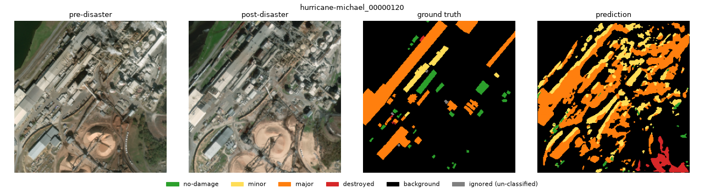
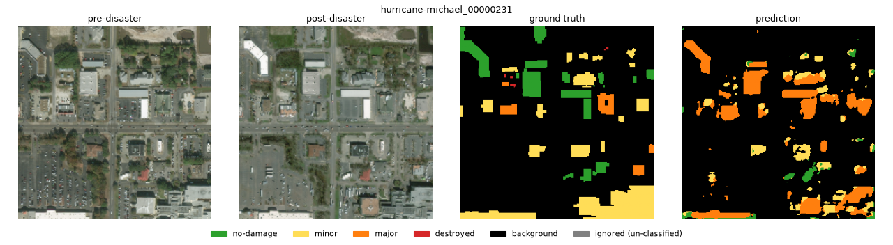
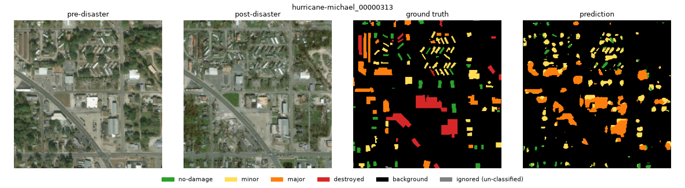

# xView2 Building Damage Segmentation

[](https://github.com/sharonkodali/xview2-damage-segmentation/actions/workflows/tests.yml)

A PyTorch pipeline that segments per-building disaster damage from paired
pre-/post-disaster satellite imagery, using the [xBD](https://xview2.org/)
dataset. Given a pre-disaster and post-disaster image of the same location,
the model predicts a per-pixel damage class for every building footprint.

Built as part of an ACM AI project team (Spring 2026), mentored by Alan.
This repo contains the data pipeline and segmentation model I personally
implemented; it reflects my individual contribution to the team's project,
not the team's full codebase.

## Problem

Natural disasters (hurricanes, wildfires, earthquakes, floods) damage
structures at a scale that's slow and dangerous for humans to assess
building-by-building. Satellite imagery captured before and after a disaster
can be used to automatically flag which buildings were damaged and how
severely, to help prioritize emergency response.

The team explored two framings of this problem:
1. **Classification** — label the single worst-damaged structure in an image.
2. **Segmentation** — label damage per-pixel/per-building footprint across
   the whole image.

This repo implements the **segmentation** approach.

## Approach

- **Input**: a 6-channel tensor — pre-disaster RGB stacked with post-disaster
  RGB for the same location ([dataset.py](dataset.py)).
- **Labels**: xBD ships building footprints as WKT polygons with a damage
  `subtype` per building. [mask_utils.py](mask_utils.py) rasterizes those
  polygons into a dense per-pixel integer mask:
  `0=no-damage, 1=minor, 2=major, 3=destroyed, 4=background`, with
  unclassified/ambiguous polygons mapped to an ignore index (255) excluded
  from the loss.
- **Model**: a standard UNet encoder-decoder with skip connections
  ([model.py](model.py)) — 6 input channels in, 5 class logits out per pixel.
- **Training** ([train.py](train.py)): configurable epochs/batch size/image
  size/base channel width, with horizontal/vertical flip augmentation
  (applied consistently to the image pair and mask), auto device selection
  (CUDA/MPS/CPU), and evaluation via a confusion matrix → per-class IoU, mean
  IoU, and pixel accuracy.

```bash
python train.py --images-dir data/train/images \
                 --labels-dir data/train/labels \
                 --epochs 30 --batch-size 4 --img-size 512
```

## Results

Trained on this Mac (Apple MPS) on a **subset of xBD**: two disaster events
from the xBD `train` split, **hurricane-michael** (343 tiles) and
**santa-rosa-wildfire** (226 tiles). The 569 tiles were randomly split by
tile (seed 42) into **484 train / 85 held-out validation**. The 1024×1024
tiles were downsampled to **256×256**. UNet with base width 32, Adam (lr 1e-3),
batch size 8, 40 epochs, cross-entropy weighted by inverse-sqrt class
frequency. Training took about an hour.

All numbers are on the 85 validation tiles, at 256×256, with
`un-classified` pixels excluded
([docs/metrics.json](docs/metrics.json)):

| metric | UNet (ours) | baseline: all background | baseline: oracle footprints + "no-damage" |
|---|---|---|---|
| IoU no-damage | 0.213 | 0.000 | 0.588 |
| IoU minor | 0.154 | 0.000 | 0.000 |
| IoU major | 0.154 | 0.000 | 0.000 |
| IoU destroyed | 0.235 | 0.000 | 0.000 |
| IoU background | 0.927 | 0.928 | 1.000 |
| **mean IoU (5 classes)** | **0.337** | 0.186 | 0.318 |
| pixel accuracy | 0.912 | 0.928 | 0.970 |
| damage accuracy (on building pixels) | 0.351 | 0.000 | 0.588 |
| F1 no-damage / minor / major / destroyed (building pixels) | 0.43 / 0.32 / 0.39 / 0.76 | 0 / 0 / 0 / 0 | 0.74 / 0 / 0 / 0 |
| **damage macro F1 (building pixels)** | **0.475** | 0.000 | 0.185 |

**How to read this:**

- **Pixel accuracy is misleading here.** 92.8% of validation pixels are
  background, so predicting background everywhere scores 0.928, higher than
  the model. The weighted loss trades a little background accuracy for
  finding damaged buildings.
- **The oracle baseline is given the true building footprints** and labels
  every building "no-damage" (the majority damage class). It gets
  localization for free, so it wins on background and no-damage IoU. The UNet
  has to find the buildings itself. It still beats the oracle on mean IoU
  (0.337 vs 0.318) and on damage macro F1 (0.475 vs 0.185), because it
  separates minor, major and destroyed buildings while the baseline can't.
- **Destroyed buildings are the easiest class** (F1 0.76). Burned-out
  wildfire lots look very different from intact ones. **Minor and major
  damage are the hardest**, and the model often confuses them (see the
  hurricane example below). Localization is also loose: footprints come out
  as blobs at 256×256.
- **These numbers are optimistic.** The checkpoint is the best validation
  mIoU out of 40 epochs (epoch 38), and there is no separate test set. The
  final epoch scored mIoU 0.289. Validation tiles also come from the same two
  events as the training tiles, so this measures performance on new tiles
  within those events, not on unseen disasters. The numbers aren't comparable
  to the official xView2 leaderboard, which uses the full dataset, full
  resolution and a different scoring formula.

### Sample predictions (validation tiles)

The evaluation script picks the validation tiles with the most damaged
pixels. They were not chosen for how good the predictions look.

**Wildfire, mostly right:** destroyed vs. intact blocks are separated well,
but the model paints whole blocks red instead of individual footprints.


**Industrial site, false positives:** damage is predicted on non-building
structures such as conveyors and storage yards.


**Hurricane, minor vs. major mixed up:** buildings are found, but minor and
major damage are often swapped.


**Hurricane, under-calls destroyed:** the large destroyed buildings in the
middle are predicted as major damage.


## Reproduce

1. Register at [xview2.org](https://xview2.org/) and download the challenge
   training set, `train_images_labels_targets.tar` (~8.4 GB).
2. Extract only the two events used here (~1.7 GB):

```bash
mkdir -p data/xbd && cd data/xbd
tar xf /path/to/train_images_labels_targets.tar \
    'train/images/hurricane-michael_*' 'train/images/santa-rosa-wildfire_*' \
    'train/labels/hurricane-michael_*' 'train/labels/santa-rosa-wildfire_*'
cd ../..
```

3. Install the dependencies, train, then evaluate:

```bash
python -m venv venv && source venv/bin/activate
pip install -r requirements.txt

python train.py --images-dir data/xbd/train/images --labels-dir data/xbd/train/labels \
    --events hurricane-michael santa-rosa-wildfire \
    --epochs 40 --batch-size 8 --img-size 256 --num-workers 4 --weighted-loss \
    --out checkpoints/unet_best.pt

python evaluate.py --checkpoint checkpoints/unet_best.pt \
    --save-examples docs --n-examples 4 --metrics-out docs/metrics.json
```

`evaluate.py` rebuilds the same validation split from the settings stored in
the checkpoint. The train/val split is deterministic. Training itself isn't
bit-for-bit deterministic on MPS, so expect small differences in the numbers.
The dataset and checkpoints are not committed (see `.gitignore`).

**Note on augmentation:** the reported run was trained before a bug in the
flip augmentation was found (by the test suite below). The horizontal flip
reversed the image's channel axis instead of its width axis, and the vertical
flip flipped the image's width while flipping the mask's height, so augmented
samples had misaligned image/mask pairs. This is fixed in
[dataset.py](dataset.py); the numbers above are from the original run and have
not been re-trained, so re-running the commands will give different results.

## Tests

The test suite runs on CPU in a few seconds and needs no xBD data: it builds
tiny synthetic image + label-JSON fixtures in a temp directory.

```bash
pip install -r requirements-dev.txt
python -m pytest
```

It covers polygon rasterisation and the damage-class mapping
([tests/test_mask_utils.py](tests/test_mask_utils.py)), dataset item shapes,
dtypes, splits and augmentation alignment
([tests/test_dataset.py](tests/test_dataset.py)), the UNet forward/backward
pass ([tests/test_model.py](tests/test_model.py)), the IoU and damage macro F1
metrics against hand-computed answers
([tests/test_evaluate.py](tests/test_evaluate.py)), and that the commands in
this README parse with the real CLIs and match the stored training settings
([tests/test_cli.py](tests/test_cli.py)). CI runs it on every push and pull
request with CPU-only PyTorch.

## Limitations & future work

(from the team's project retrospective)
- Limited timeline meant only a subset of disaster events in xBD were used.
- Human-annotated damage labels can be inconsistent across annotators.
- Different disaster types (fire vs. flood vs. earthquake) have visually
  distinct damage signatures that a single model may not generalize across.
- Future work: train on all xBD events at full resolution, hold out whole
  disasters as a test set, use a pretrained encoder, and train the
  classification track for longer.

## Credit

This was a team project for ACM AI, mentored by Alan. This repo isolates and
presents the data pipeline + UNet segmentation implementation I wrote; the
classification (DenseCNN/ViT) work referenced above was built by other team
members.
